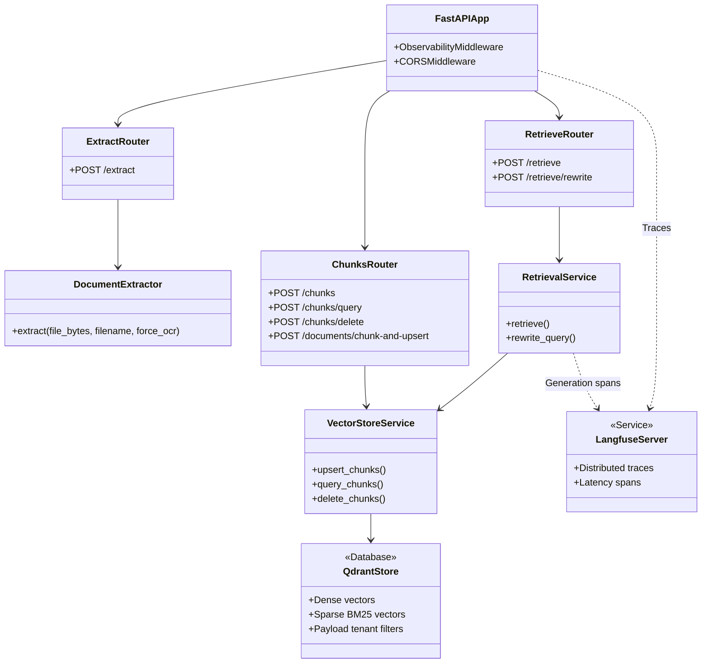
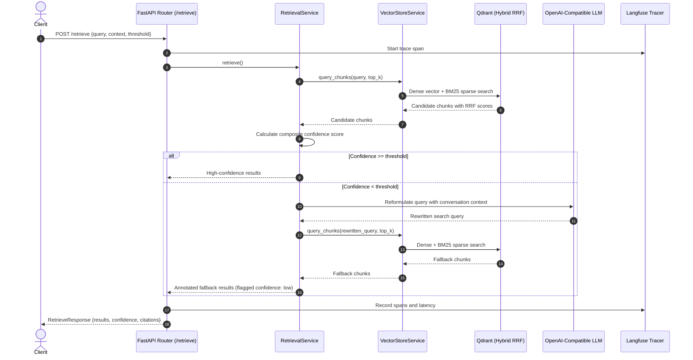

# PAT RAG Core

PAT RAG Core implements the open-source retrieval-augmented generation engine for the PAT AI Platform. It replaces proprietary cloud dependencies with open-source services running in Podman containers.

## Architecture

The service runs as a unified FastAPI application and provides three core capabilities:

- **Document extraction (`/extract`)**: Docling extracts text from PDF and DOCX files in memory. It applies optical character recognition to scanned pages, preserves 1-based page numbers, and formats tables into pipe-delimited text marked with `[Table N]`.
- **Vector storage and hybrid search (`/chunks`)**: Qdrant stores document chunks with dense embeddings and sparse BM25 vectors. It uses Reciprocal Rank Fusion to merge results and applies payload filters to isolate tenant namespaces.
- **Agentic retrieval (`/retrieve`)**: A LangChain pipeline scores retrieval quality using hybrid similarity and query keyword coverage. When scores fall below the configured threshold, the pipeline reformulates the query and runs a bounded fallback retrieval.
- **Observability and evaluation**: Langfuse captures execution traces with span latencies and token counts. Ragas evaluates retrieval quality through golden test datasets.

### Component diagram

The component diagram shows the relationship between routers, services, and external datastores:



### Sequence diagram

The sequence diagram shows the agentic retrieval flow with confidence evaluation and fallback re-query:



## Host requirements

You need the following tools on your host machine:

- Podman 4.0 or newer
- Podman Compose

Do not install Python packages or runtimes on the host machine. All execution occurs inside Podman containers.

## Configure the environment

Copy the example environment file to create your local configuration:

```bash
	cp .env.example .env
```

Set the following variables in `.env` if you use external language model features:

- `OPENAI_API_KEY`: API key for dense embeddings and query reformulations.
- `OPENAI_BASE_URL`: Base URL for OpenAI-compatible APIs (defaults to `https://api.openai.com/v1`).
- `QDRANT_URL`: URL of the Qdrant instance (defaults to `http://localhost:6333` on the host, or `http://qdrant:6333` inside Compose).
- `LANGFUSE_PUBLIC_KEY`: Public key for Langfuse tracing.
- `LANGFUSE_SECRET_KEY`: Secret key for Langfuse tracing.
- `LANGFUSE_HOST`: URL of the Langfuse server (defaults to `http://localhost:3000`).

Tracing and evaluations run in mock mode when you omit these keys.

## Start the services

To start all background services (Qdrant, Langfuse, PostgreSQL, and the API), run the compose command:

On Linux or macOS:

```bash
	./scripts/dev.sh up
```

On Windows:

```powershell
	.\scripts\dev.ps1 up
```

To stop all background services, run:

On Linux or macOS:

```bash
	./scripts/dev.sh down
```

On Windows:

```powershell
	.\scripts\dev.ps1 down
```

## Start the development server

To run the FastAPI server with hot reloading on port 8000, run:

On Linux or macOS:

```bash
	./scripts/dev.sh run
```

On Windows:

```powershell
	.\scripts\dev.ps1 run
```

The application starts at `http://localhost:8000`. You can inspect the interactive OpenAPI documentation at `http://localhost:8000/docs`.

To debug with `debugpy` attached on port 5678, run:

On Linux or macOS:

```bash
	./scripts/dev.sh debug
```

On Windows:

```powershell
	.\scripts\dev.ps1 debug
```

## API reference

### Health check

- `GET /health`: Returns service health status and active environment name.

### Document extraction

- `POST /extract`: Extracts text and tables from an uploaded file or a blob URL. Accepts `multipart/form-data` with `file` and `filename`, or `application/json` with `blob_url` and `filename`. Set `force_ocr: true` to bypass native text extraction.

### Vector chunk management

- `POST /chunks`: Upserts pre-split chunks with metadata into a tenant namespace.
- `POST /chunks/query`: Queries chunks using hybrid search, optional metadata filters, and Reciprocal Rank Fusion.
- `POST /chunks/delete`: Deletes chunks scoped to a full namespace or to a single document within a namespace.
- `POST /documents/chunk-and-upsert`: Splits document text into chunks and upserts them into a namespace in one step.

### Agentic retrieval

- `POST /retrieve`: Retrieves matching passages with confidence scoring, plain-language explanations, source citations, and automatic fallback query rewriting.
- `POST /retrieve/rewrite`: Rewrites conversational follow-up questions into standalone search queries.

## Run tests

To run the test suite in an isolated container, run:

On Linux or macOS:

```bash
	./scripts/dev.sh test
```

On Windows:

```powershell
	.\scripts\dev.ps1 test
```

The test suite runs 53 tests covering extraction, vector operations, retrieval logic, evaluations, and observability middleware.

## Run evaluations

To run evaluations against the golden dataset in mock mode, run:

```bash
	podman run --rm -v "${PWD}:/app:z" -w /app ghcr.io/astral-sh/uv:python3.12-bookworm-slim uv run python evals/run_evals.py --mock
```

To run evaluations with live retrieval against a running Qdrant instance, run:

```bash
	podman run --rm -v "${PWD}:/app:z" -w /app --env-file .env ghcr.io/astral-sh/uv:python3.12-bookworm-slim uv run python evals/run_evals.py --live
```

The evaluation runner measures four metrics:

- `context_precision`: Checks whether relevant passages appear at top ranks.
- `context_recall`: Checks whether retrieved passages cover reference facts.
- `faithfulness`: Checks whether answers contain only claims from retrieved contexts.
- `answer_relevancy`: Checks whether answers address the user question.

## Run the linter

To check code style and formatting rules with Ruff, run:

On Linux or macOS:

```bash
	./scripts/dev.sh lint
```

On Windows:

```powershell
	.\scripts\dev.ps1 lint
```

## Repository layout

The repository contains 37 tracked files. You can regenerate the file list with `git ls-files`:

```text
	.env.example                     Example environment configuration
	.github/workflows/ci.yml         GitHub Actions CI pipeline
	.gitignore                       Git ignore rules
	CLAUDE.md                        Project instructions and environment rules
	Containerfile                    Production container build definition
	Containerfile.dev                Development container definition
	GLOSSARY.md                      Domain terminology reference
	README.md                        Project guide and reference
	evals/data/golden_dataset.json   Evaluation test cases
	evals/run_evals.py               Evaluation runner script
	podman-compose.yml               Multi-container deployment file
	pyproject.toml                   Project metadata and dependencies
	requirements.md                  Full PAT AI Platform specification
	requirements.txt                 Pinned dependencies
	scripts/dev.ps1                  PowerShell development script
	scripts/dev.sh                   Bash development script
	src/config.py                    Application settings
	src/constants.py                 Shared constants and stopwords
	src/main.py                      FastAPI application entry point
	src/routers/chunks.py            Chunk upsert and search endpoints
	src/routers/extract.py           Document extraction endpoints
	src/routers/retrieve.py          Retrieval and rewrite endpoints
	src/services/extractor.py        Docling extraction service
	src/services/observability.py    Langfuse tracing middleware
	src/services/retrieval.py        Agentic retrieval and query rewriting
	src/services/vector_store.py     Qdrant vector database client
	tests/                           Pytest test suite (53 tests)
```
